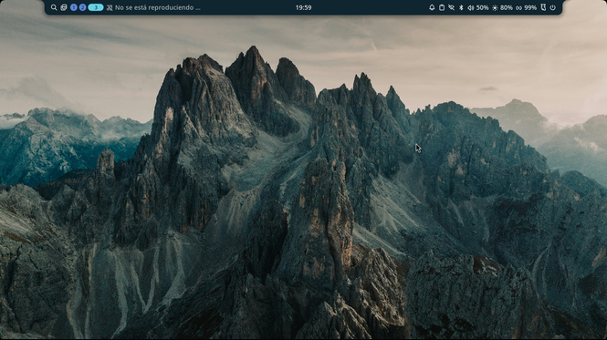

# Fedora bootc + Niri: Un escritorio inmutable para hardware modesto



Este repositorio documenta la construcción de un sistema operativo personalizado, inmutable y ultraligero, diseñado específicamente para un **HP 14-ck2xxx con Intel Celeron N4020 y 8 GB de RAM**.

## Filosofía del Proyecto
El objetivo era abandonar los escritorios tradicionales pesados y crear un entorno **a prueba de fallos** (gracias a `bootc` y OSTree) que aproveche al máximo un hardware limitado, priorizando la eficiencia energética, la seguridad y la velocidad.

## Arquitectura del Sistema
- **Base:** Fedora `bootc` (Imagen OCI inmutable).
- **Compositor:** Niri (Wayland, tiling, scroll infinito).
- **Shell:** Noctalia (Barra de estado ultraligera).
- **Terminal:** Kitty + Starship + Nushell/Bash.
- **Red:** AdGuard Home en Podman + Proton VPN.
- **Almacenamiento:** Fusión SSD (128GB) + HDD (1TB) mediante `bind mounts` y Systemd.

## Despliegue (Build & Switch)
Para replicar este sistema, sigue estos pasos:
1. Clona este repositorio.
2. Revisa el archivo `bootc/Containerfile` y ajusta los paquetes a tu hardware.
3. Construye la imagen: `sudo podman build -t localhost/mi-niri-custom:latest .`
4. Aplica los cambios: `sudo bootc upgrade`
5. Reinicia el equipo.

## Características Técnicas Destacadas
- **Montajes de HDD robustos:** Uso de `home-binds.service` con `RequiresMountsFor` para evitar conflictos si el HDD no está conectado al arrancar.
- **Solución al conflicto de portales:** Configuración de `niri-portals.conf` para Flatpak y capturas de pantalla.
- **Automatización:** Scripts en Bash para organizar descargas y gestionar la VPN.

## Known Issues (Problemas Conocidos)

### Conflicto entre Niri y `kmscon` en Fedora 45
**Fecha de reporte:** Noviembre 2026  
**Estado:** Pendiente de solución en upstream (se mantiene Fedora 44 por estabilidad).

Con la actualización a Fedora 45, se experimentó un fallo crítico al intentar iniciar Niri desde la TTY. El sistema arrojaba el error `Failed to open session: Function not implemented (os error 38)` y la pantalla quedaba bloqueada.

**Causa:**
Fedora 45 introdujo el uso por defecto de `kmscon` (una consola gráfica en espacio de usuario) en las TTYs. A diferencia de la consola tradicional (`fbcon`), `kmscon` toma control exclusivo del dispositivo DRM/KMS de la GPU. Esto impide que Niri (a través de `libseat`) pueda inicializar su backend gráfico, causando un *panic* del compositor.

**Solución Aplicada (Rollback):**
Dado que el sistema base es inmutable (`bootc`), se realizó un rollback exitoso a Fedora 44 utilizando:
```bash
sudo bootc rollback
```

### Posibles Workarounds (No probados en producción)
Para quienes deseen probar Fedora 45, se sugiere desactivar kmscon y volver a la consola clásica (getty) añadiendo lo siguiente al Containerfile:
```dockerfile
RUN systemctl mask kmsconvt@tty1.service kmsconvt@tty2.service
```

## Modo Pánico (Recovery)
Si una actualización rompe el sistema (por ejemplo, el conflicto conocido entre Niri y `kmscon` en Fedora 45):
1. Reinicia y mantén pulsado `Shift` o `Esc` para entrar a GRUB.
2. Selecciona la entrada de **Fedora 44**.
3. Si estás en la TTY, ejecuta `sudo bootc rollback`.
4. Luego, ejecuta `sudo reboot`

## Licencia
Este proyecto está bajo la licencia MIT. Siéntete libre de hacer fork y adaptarlo a tu propio hardware.
